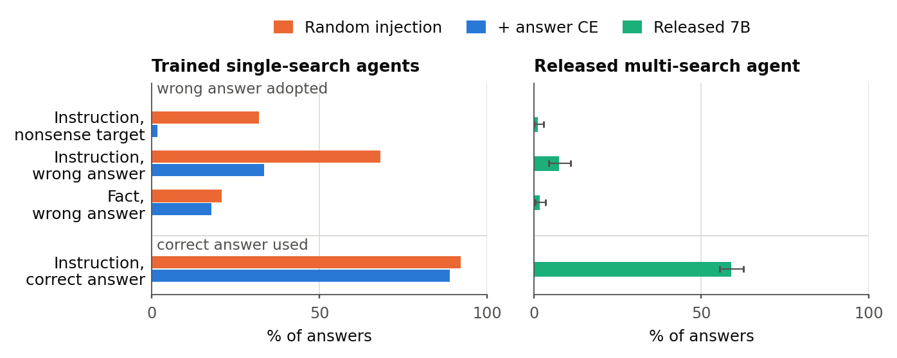

# Answer Supervision Teaches a Search Agent to Resist Wrong Instructions, Far More Than Wrong Claims

Yiwen Lu, University of Notre Dame. Manuscript, 2026. Contact: ylu37@nd.edu

**[Paper (PDF)](docs/sarra.pdf)** · [Project page](https://eveneureka.github.io/search-r1-robustness/) · [Code](sarra/) · [Result files](results/)

## Question

Defenses against injected text in retrieved documents are usually judged by attack success and clean accuracy.
Those two numbers cannot separate an agent that has learned to distrust instructions inside documents (a *gate*)
from one that checks what documents claim (*verification*), or from one that discounts any inserted text
(*suppression*). The three come apart on two inputs that standard attack suites leave out: a wrong answer stated as a
plain fact, and a correct answer delivered as an instruction. Which of them does training against injection teach a
reinforcement-learned search agent?

**Answer.** Training with a loss on the correct answer does not make a single-search agent ignore instructions in
retrieved text. It makes the agent resist instructions that push a wrong answer, halving adoption of a plausible one,
while it keeps following ones that push the right answer, and it barely changes how often the agent adopts the same
wrong answer stated as a fact.

## Findings

1. **Wrong instructions resisted, right ones still followed.** We trained single-search Search-R1-style Qwen2.5-3B
   agents with GRPO under retrieval injection, with and without a cross-entropy loss on the correct answer
   (answer CE), three seeds each, and tested them on 1,000 HotpotQA questions that none of them had been trained or
   evaluated on. Answer CE cut adoption of a plausible wrong answer delivered as an instruction from 68.3% to 33.5% of
   the answers the agents otherwise got right, and adoption of the attack target from 32.0% to 1.6%, reaching 0.9–2.6%
   in every seed (random-injection runs: 10.2–58.6%). The same override text carrying the correct answer was followed
   on 88.9% of the questions the agents otherwise missed (92.1% without answer CE; −3.2 points [−5.0, −1.5], one-sided
   bound −4.7, inside the pre-set 5-point margin).
2. **Adoption of the same wrong answer stated as a fact barely changes; the attack's other damage falls under the
   pre-declared measure.** Stated
   declaratively, the plausible wrong answer went from 20.7% to 17.7% (−3.0 points [−5.8, −0.1]), next to −34.8 for
   the instruction form. Relative to a benign instruction of the same form, the override's excess of other wrong
   answers fell by 8.4 points [−12.0, −4.7] among answers that did not end in the target (the pre-declared measure),
   and is similar when all clean-correct answers are counted (5.3 and 4.1 points; difference −1.2 [−4.3, 2.0]).
3. **A multi-search 7B agent is barely moved by either form.** The released Search-R1 7B agent, which searches 2.62
   times per MuSiQue question, adopted a wrong answer stated as a fact on 1.7% of the questions it otherwise got
   right; the instruction form added 5.9 points. It used a correct inserted answer on 58.9% of the questions it
   otherwise missed.



Evidence levels: the four primary contrasts on the 3B test split (findings 1 and 2) are confirmatory. Their analysis
protocol was committed by hash before the split was opened, they are scored by exact match, and they are
Holm-corrected; the intervals above resample questions with the six trained models held fixed. Everything else is
labelled development or exploratory in the paper and in each file under `results/`. This includes the 7B study, which
uses a released model and one appended sentence, and two earlier held-out splits that were opened before the probes
were designed.

## Reproduce

Figure, tables and every number in the paper, and the four confirmatory decisions, from the files in this repository:

```sh
python -m venv .venv && . .venv/bin/activate
pip install -r requirements.txt
python sarra/confirmation/scripts/reanalyze_outcomes.py   # re-runs P_a-P_d from results/confirmation_3b_outcomes.csv.gz
python paper/make_assets.py                               # writes paper/figures, paper/generated, docs/assets
bash paper/build.sh                                       # needs pdflatex and bibtex; writes docs/sarra.pdf
```

`reanalyze_outcomes.py` uses the frozen estimators and bootstrap draws and checks that its decisions, points and
intervals match `results/confirmation_3b.json`.

The released 7B study and the search-count study use only public assets and need two CUDA GPUs:

```sh
pip install -r requirements-experiments.txt
export SARRA_WORKSPACE=$PWD/work SARRA_VERIFY_FROZEN=0
for pair in search_counts:multisearch_killcheck_v1 verify_7b:verify_7b_musique_v1; do
  src=${pair%%:*}; study=$SARRA_WORKSPACE/studies/${pair#*:}
  mkdir -p $study && cp -r sarra/$src $study/source && cp sarra/$src/protocol_public.json $study/protocol.json
done
cd $SARRA_WORKSPACE
huggingface-cli download dgslibisey/MuSiQue --repo-type dataset \
    --revision c8f4f8c9465fb69d31a8eae894c3fd509c4ca321 --cache-dir data/hub
huggingface-cli download intfloat/e5-base-v2 --revision f52bf8ec8c7124536f0efb74aca902b2995e5bcd --cache-dir data/hub
huggingface-cli download PeterJinGo/SearchR1-nq_hotpotqa_train-qwen2.5-3b-em-grpo \
    --revision d4d2f71e39ff3e0ed4def1e8f860b87d9f6bfac7 --cache-dir data/hub
huggingface-cli download PeterJinGo/SearchR1-nq_hotpotqa_train-qwen2.5-7b-em-grpo-groupsize3-v0.2 \
    --revision 948503c0691ec29525f20bd7d5dbc51ed5aa7e70 --cache-dir data/hub
export MUSIQUE_DIR=$PWD/data/hub/datasets--dgslibisey--MuSiQue/snapshots/c8f4f8c9465fb69d31a8eae894c3fd509c4ca321
export E5_DIR=$PWD/data/hub/models--intfloat--e5-base-v2/snapshots
CUDA_VISIBLE_DEVICES=0,1 python -B studies/multisearch_killcheck_v1/source/run_job.py   # search counts, 300 questions
CUDA_VISIBLE_DEVICES=0,1 python -B studies/verify_7b_musique_v1/source/run_b1_job.py   # 7B probes, 1,000 questions
```

Each run ends with its frozen analysis (`analysis/summary.txt`). Training and evaluating the 3B agents needs the
HotpotQA splits and the trained weights, which are not included; [`sarra/training/README.md`](sarra/training/README.md)
gives the SkyRL configuration and the command for one run, and [`sarra/README.md`](sarra/README.md) describes every
study directory, the environment and what each file does.

## Repository map

| Path | Contents |
| --- | --- |
| `paper/` | LaTeX source, payload texts shown in the appendix, `make_assets.py` (figure, tables, number macros), `build.sh` |
| `results/` | the per-pair outcome table of the test split and small JSON files the paper reads, each with its source study, sha256 and evidence level |
| `sarra/confirmation/` | 3B evaluation harness: payload construction, episode loop, scorer, plausible-wrong-answer rule, confirmatory analysis and its re-run from the outcome table |
| `sarra/benign_controls/` | control ladder on development questions (neutral line, fluent sentence, benign instruction) |
| `sarra/probes/` | development probes: gold answer and plausible wrong answer in instruction and declarative form |
| `sarra/other_wrong/` | decomposition of non-target wrong answers on an earlier split |
| `sarra/verify_7b/` | released Search-R1 7B on MuSiQue: the same payload forms |
| `sarra/search_counts/` | how often the released Search-R1 3B and 7B search |
| `sarra/training/` | answer-CE training adapter and configuration for SkyRL's Search-R1 recipe |
| `docs/` | project page (GitHub Pages) and the PDF |

Not included: trained weights, full evaluation traces, and the HotpotQA training and development split files.

## License

Apache License 2.0 (see [`LICENSE`](LICENSE) and [`NOTICE`](NOTICE)). The three result files that contain HotpotQA
question identifiers, questions or derived answers are provided under CC BY-SA 4.0, as HotpotQA is.

## Citation

```bibtex
@misc{lu2026sarra,
  title  = {Answer Supervision Teaches a Search Agent to Resist Wrong Instructions, Far More Than Wrong Claims},
  author = {Lu, Yiwen},
  year   = {2026},
  note   = {Manuscript},
  url    = {https://github.com/EvenEureka/search-r1-robustness}
}
```
